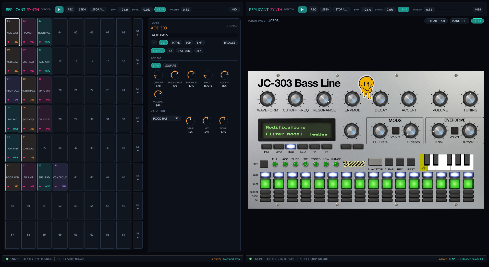
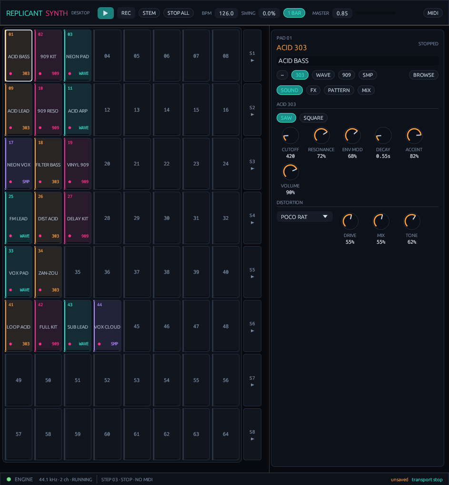
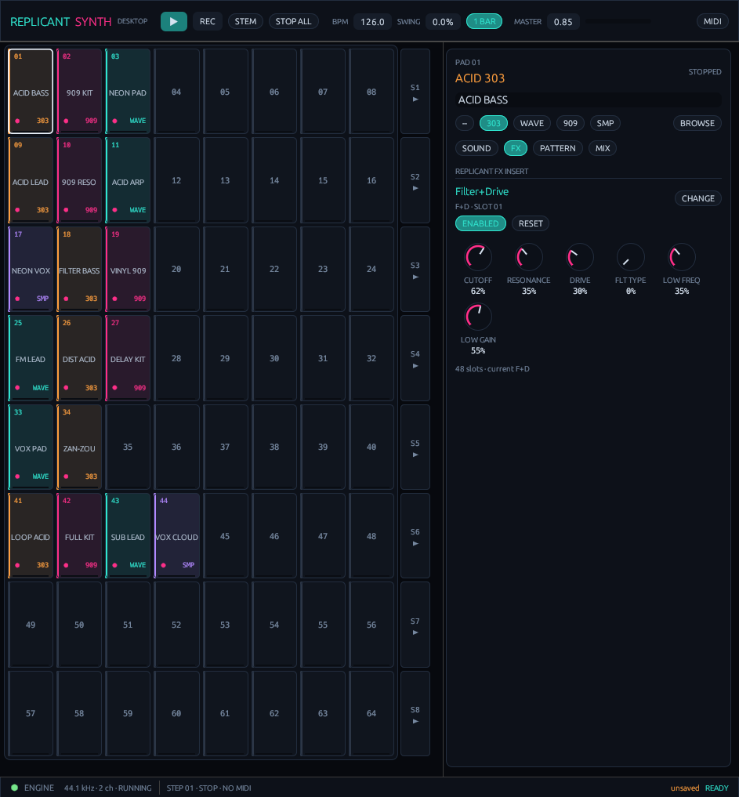
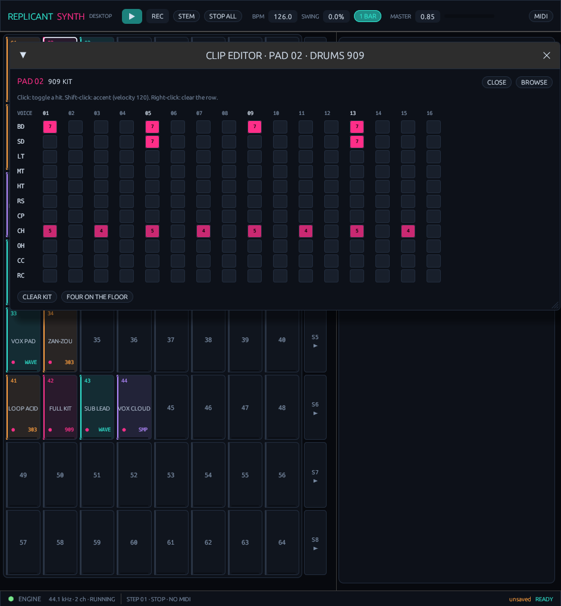
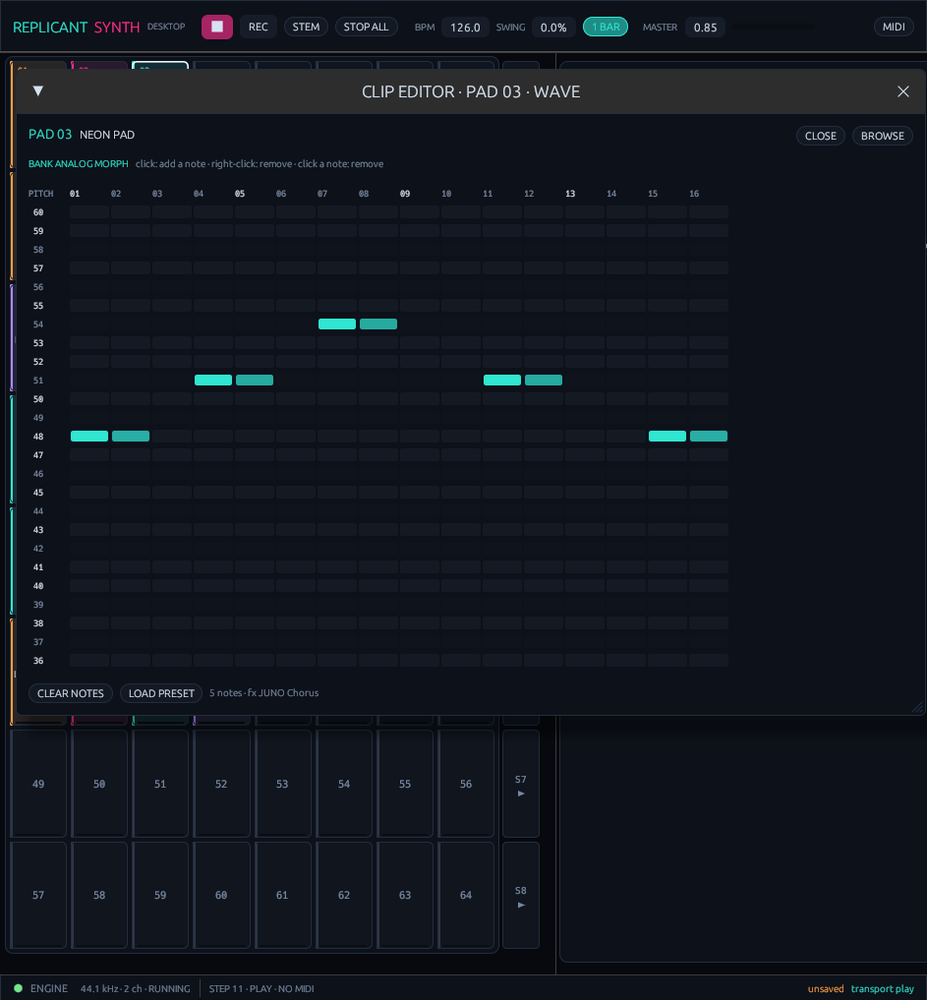
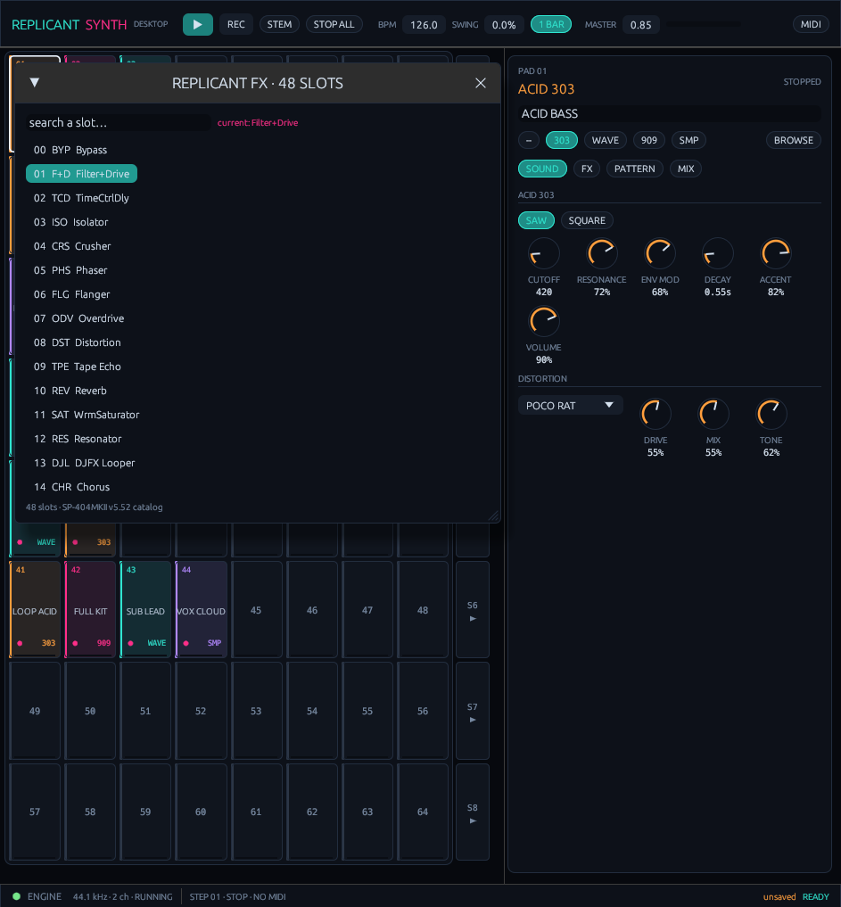
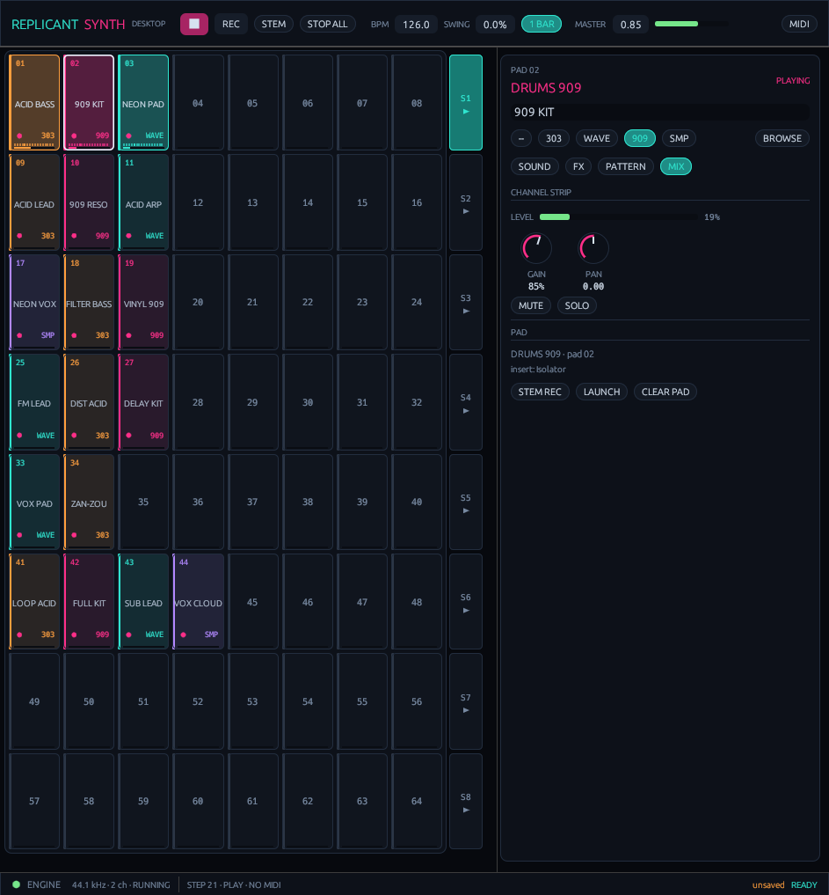

# REPLICANTSYNTH // DESKTOP

<p align="center">
  <strong>A cross-platform Rust clip launcher that unites Replicant303, ReplicantWave, Replicant909 and ReplicantFX on one 8 × 8 pad surface.</strong><br>
  <em>Rust · egui / eframe · cpal · midir · Symphonia · APC64</em>
</p>

<p align="center">
  <a href="https://github.com/DanimanX/ReplicantSynthDesktop/actions/workflows/desktop.yml">
    
  </a>
  <a href="https://github.com/DanimanX/ReplicantSynthDesktop/releases/tag/0.0.1">
    
  </a>
  
  
</p>

<p align="center">
  📦 <strong><a href="https://github.com/DanimanX/ReplicantSynthDesktop/releases/tag/0.0.1">Download the desktop build (0.0.1)</a></strong>
</p>

<p align="center">
  
</p>

<p align="center">
  <em>64 pads with live meters and step phase · the ReplicantWave piano roll, both captured from the running app.</em>
</p>

---

## What it is

**ReplicantSynth Desktop** is the desktop sibling of
[ReplicantSynthAndroid](https://github.com/DanimanX/ReplicantSynthAndroid). It
keeps the same clip-launcher idea — 64 pads, each a clip slot with its own
engine, pattern, ReplicantFX insert and mixer strip — and rebuilds it as a
native cross-platform application in Rust.

- **Replicant303** — acid bass voice: polyBLEP oscillator, diode ladder filter,
  capacitor slide, accent envelope and the five-model distortion unit.
- **ReplicantWave** — 8 wavetable banks × 16 frames × 7 mip levels, up to 8
  unison voices, ZDF filter, sub, noise, ADSR and chord mode.
- **Replicant909** — the 11 circuit-level voices (BD, SD, LT, MT, HT, RS, CP,
  CH, OH, CC, RC) with closed-hat choke and a linear, headroom-trimmed bus.
- **ReplicantFX** — all **48** SP-404MKII MFX slots, six firmware macros per
  slot, one insert per pad.

Everything runs in one pure-Rust engine. The UI never touches the audio thread:
it sends commands through a lock-free ring and reads atomics.

## Features

- **64 LED pads / 8 × 8 grid** with clip state (stopped, queued, playing), kind
  colour, FX dot, per-pad meter and the live step phase.
- **Ableton-style launching**: per-clip launch/stop, global launch quantization
  (OFF, 1/16, 1/4, 1 bar, 2 bars, 4 bars), scene launch and scene stop.
- **Per-pad engines**: switch a pad between 303, Wave, 909 and audio without
  leaving the grid (row of chips in the inspector, or right-click a pad).
- **Clip editors**: a 16-step acid sequencer with accent/slide lanes, an
  11 × 16 kit grid, and a piano roll with sustained, polyphonic MIDI notes.
- **Factory presets**: 512 Replicant303 lines (8 banks × 64), the 8 classic
  Replicant909 patterns and all 44 ReplicantWave sounds, with a searchable
  browser.
- **Per-pad ReplicantFX insert**: all 48 slots, dynamic six-parameter labels and
  factory defaults from the firmware table.
- **Sample import**: WAV, FLAC, MP3, OGG/Vorbis, AAC/M4A via Symphonia, with
  loop / one-shot and pitch.
- **24-bit capture**: master take or single-pad stem, written by a dedicated
  writer thread while the audio callback stays allocation-free. Takes load back
  into a sample pad with one click.
- **APC64 support**: real Akai SysEx handshake, 64 pads, 8 scene buttons,
  transport, record, encoder, touch strips, LED feedback and OLED labels.
- **Project persistence**: JSON project with all 64 clips, patterns, FX, mixer
  state and sample references; autosave every 15 s.
- **Desktop-native window**: grid on the left, inspector on the right, a
  responsive transport bar, keyboard shortcuts, and a headless screenshot mode
  used by CI.

## Screenshots

<p align="center">
  
  
  
</p>
<p align="center">
  <em>Running scene with live meters · the 303 sound panel · the 11 × 16 kit grid</em>
</p>

<p align="center">
  
  
  
</p>
<p align="center">
  <em>ReplicantWave piano roll · all 48 SP-404MKII slots · the channel strip riding a live level</em>
</p>

Every capture comes from the running binary on Linux (X11, 1480 × 920), taken by
`REPLICANTSYNTH_SCREENSHOT=… cargo run` — no mock-ups.

## Quick start

1. Install Rust 1.85 or newer (`rustup` is the easy path).
2. Clone and run:

   ```bash
   git clone https://github.com/DanimanX/ReplicantSynthDesktop.git
   cd ReplicantSynthDesktop
   cargo run --release -p replicantsynth-desktop
   ```

3. The **NEON GRID** demo is created on first launch with six scenes, a bundled
   vocal sample and a 303 / 909 / Wave / FX clip on every row.
4. Press **Space** or **▶** to start the transport, then click pads `01`, `02`,
   `03` to launch the first scene. The `1 BAR` chip sets launch quantization.
5. Click a pad to select it; the inspector shows **SOUND / FX / PATTERN / MIX**.
6. **Double-click a clip** to open its editor. **BROWSE** in SOUND opens the
   preset browser.
7. **REC** captures the master, **STEM** captures the selected pad. Takes land
   in the app data directory and can be loaded into a sample pad.
8. Plug in an APC64 over USB and press **MIDI → CONNECT APC64**.

### Where files live

- **Linux**: `~/.local/share/ReplicantSynth` (or `$XDG_DATA_HOME/ReplicantSynth`)
- **macOS**: `~/Library/Application Support/ReplicantSynth`
- **Windows**: `%APPDATA%\ReplicantSynth`

Override the location with `REPLICANTSYNTH_HOME=/some/dir`.

The project file is `project.json`; captures go to `Recordings/`.

## Shortcuts

- `Space` — play / stop
- `R` — capture the master
- Arrow keys — move the pad selection
- `Delete` — clear the selected pad
- `Ctrl/Cmd+S` — save · `Ctrl/Cmd+O` — open · `Ctrl/Cmd+N` — new project
- Double-click a pad — clip editor; right-click — pad menu
- Drag a knob — change the value; `Shift` drags finer; double-click resets it

## Demo audio

A 42-second arrangement rendered by the real engine (all four instruments, six
scenes, per-pad FX):

[`assets/replicantsynth_demo.mp3`](assets/replicantsynth_demo.mp3)

Regenerate it locally:

```bash
cargo run --release -p replicantsynth-core --bin render-demo -- \
    --out assets/replicantsynth_demo.wav --seconds 42 \
    --sample assets/demo/neon_stab.wav
```

The renderer drives the same clip engine and 24-bit capture path as the app, with
no audio device open, so it runs on CI.

## APC64 mapping

| Control | Message | Action |
| --- | --- | --- |
| 64 pads | Notes 0–63, note 0 = bottom-left | Launch / stop / select clip |
| Scene buttons | Notes 112–119 | Launch row; right-click on screen stops the row |
| Play / Stop | Notes 91 / 93 | Transport start / stop |
| Record | Note 92 | Toggle master capture |
| Clip Stop | Note 111 | Stop all clips |
| Mute / Solo | Notes 109 / 110 | Toggle the selected pad mute / solo |
| Notes / Chord surface | Notes cable, pitches 0–127 | Audition the selected clip's engine |
| Step Seq | Notes cable in Step mode | Toggle steps on the selected 303 / 909 clip |
| Cursor up / down / left / right | Notes 94 / 95 / 96 / 97 | Move the pad selection |
| Encoder | CC 90 (two's complement) | Nudge BPM |
| Touch strips | Pitch-bend channels 1–8 | Strip 1 master, strip 8 pad gain |
| Strip LEDs | Pitch bend + CC 104–111 / 112–119 | Bar position, style and colour |
| LEDs | Note-on, channel 6 / 0 | Full / half brightness |
| OLED | SysEx 0x10 / 0x1A | `REPLICANT`, BPM, quantize, pad |

The app sends the Akai mode handshake on connect:

```
F0 47 00 53 1B 00 01 00 F7   track type
F0 47 00 53 19 00 01 00 F7   generic/DAW mode
F0 7E 7F 06 01 F7            identity request
F0 47 00 53 1C 00 01 01 F7   take display ownership
F0 47 00 53 10 ... F7        OLED labels
```

It reads the unit's pad-mode report `F0 47 00 53 19 00 01 <m> F7`. On firmware
**1.2.1.6** the validated mode map is `0` Session, `2` Note, `3` Chord, `6` Step,
`8` Project, `9` Custom. Note/Chord pads arrive on the Notes cable; the DAW pad
grid is only treated as clips in Session/Overview. A **BASE 0 / BASE 36** switch
and a **FLIP PAD ROWS** switch cover stock Ableton DAW mode, the Akai custom
project layout and FreeAPC64 firmware.

## Build

Requirements: a stable Rust toolchain (1.85+), and on Linux the usual native
packages for windowing and audio.

```bash
# Debian / Ubuntu
sudo apt-get install build-essential pkg-config libasound2-dev \
    libxkbcommon-dev libwayland-dev libx11-dev libxcb1-dev libudev-dev

# Fedora
sudo dnf install gcc pkgconf alsa-lib-devel libxkbcommon-devel \
    wayland-devel libX11-devel libxcb-devel systemd-devel

# Arch
sudo pacman -S --needed base-devel pkgconf alsa-lib libxkbcommon \
    wayland libx11 libxcb systemd-libs
```

macOS and Windows need no extra packages (CoreAudio / WASAPI come with the OS).

```bash
cargo build --release -p replicantsynth-desktop      # binary
cargo test  --release --workspace                    # engine + UI-free tests
cargo clippy --workspace --all-targets -- -D warnings
cargo fmt --all --check
```

The binary lands in `target/release/replicantsynth` (`replicantsynth.exe` on
Windows). `cargo run --release -p replicantsynth-desktop` runs it directly.

## Verification

- **Test suite** (`cargo test --release --workspace`): 26 tests.
  13 in the engine — wavetable banks, the 303 voice, Wave polyphony, all 48 FX
  slots, launch quantization, scenes, sample playback, 24-bit capture, transport
  stop, the peak guard with eight simultaneous drum clips, the preset banks, JSON
  round-trip and a full demo render. 13 in the desktop shell — pad/note mapping,
  the Akai SysEx envelope, pad-mode and firmware parsing, the incremental MIDI
  parser (running status, split packets, zero-velocity note-on), the LED palette,
  port roles, and Symphonia decoding of WAV, MP3, FLAC, OGG and M4A.
- **Offline render**: a 42-second arrangement written through the real capture
  path, measured with `ffprobe` as `pcm_s24le`, 48 kHz stereo, peak −0.1 dBFS.
- **Headless UI capture**: the app renders itself and writes a PNG
  (`REPLICANTSYNTH_SCREENSHOT=out.png`), which is how the screenshots above were
  produced in CI-sized steps.
- **APC64 hardware**: the protocol, handshake, port roles and LED palette are
  covered by unit tests; a physical APC64 was not attached to the CI runner.
  Please report device-specific quirks.

## Architecture

```
egui / eframe  (UI thread)
  │   commands · atomics · sample publication
  ▼
EngineHandles ─ ArrayQueue<Command> ─▶ ClipEngine (audio callback)
                                       ├── 64 Clip slots: 303 · Wave · 909 · Sample
                                       ├── per-pad ReplicantFX (48 slots)
                                       ├── 16th transport, quantization, scenes, tails
                                       └── 2 × RecordTap → RecordingWriter (24-bit WAV)
  ▼
cpal → ALSA / CoreAudio / WASAPI / JACK
```

Full design notes: [docs/ARCHITECTURE.md](docs/ARCHITECTURE.md).

## Project layout

```
crates/replicantsynth-core/          engine, no I/O, no window, no device
  src/dsp/                           primitives, 303, wavetable, 909, 48-slot FX
  src/engine/                        clip engine, command ring, telemetry, recorder
  src/model/                         clips, presets, demo project, JSON store
  src/bin/render_demo.rs             offline arrangement renderer
  tests/engine.rs                    regression suite
crates/replicantsynth-desktop/       the application
  src/audio.rs                       cpal stream, device selection
  src/decode.rs                      Symphonia sample import
  src/midi.rs                        MIDI parser, APC64 profile, LED/OLED
  src/ui/                            theme, widgets, pad grid, inspector, editors
```

## Known limits / roadmap

- **One insert per pad.** ReplicantFX's dual-bus serial/parallel routing is a
  plug-in feature; 0.0.1 runs one selected slot per pad.
- **The wavetable port is an architecture port**, not a byte-for-byte Rust port
  of the ReplicantWave plug-in: same 8 banks, morphing, unison, sub/noise and ZDF
  filter, driven by the clip sequencer. The 44 Wave presets map osc 1, sub,
  noise, filter and amp; desktop osc 2 / chorus / delay / reverb become the
  per-pad ReplicantFX insert.
- **The piano roll is one 16-step bar.** Notes can start on any step and sustain
  up to 16 steps.
- **Samples loop by length**, not by musical time-stretch. Pitch is resampling.
- **A single audio stream.** There is no plug-in build yet (VST3/CLAP); the app
  is a standalone instrument.
- **Touch strips** are mapped to master and pad gain; per-strip assignment is a
  roadmap item.

## License

MIT. The four upstream instruments are MIT by the same author. See
[LICENSE](LICENSE) and [NOTICE](NOTICE).

ReplicantSynth is free and open source. If it earns a place in your setup, you
can buy me a coffee — completely optional:

[paypal.me/DanimanX](https://paypal.me/DanimanX?locale.x=en_US&country.x=CL)
